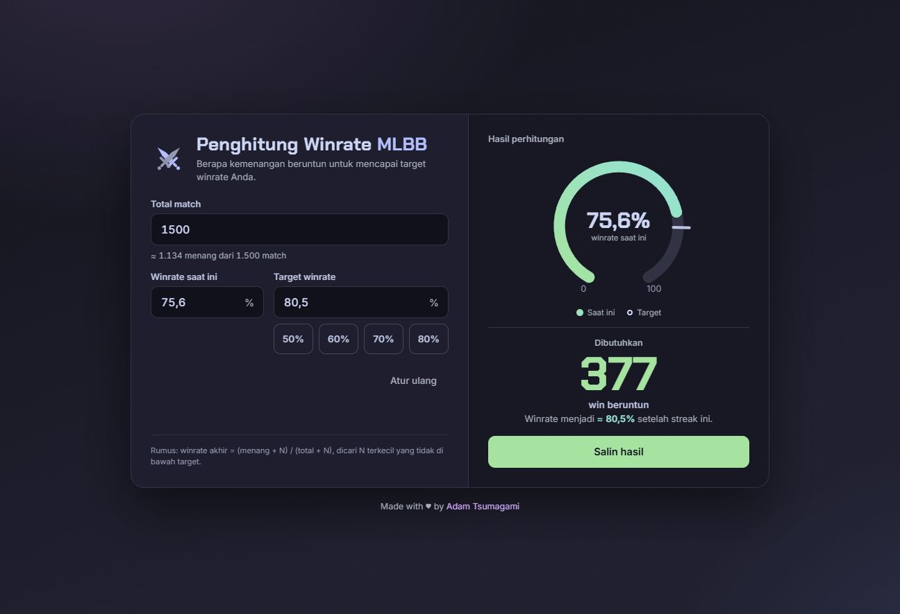

# Penghitung Winrate MLBB



Aplikasi web satu halaman untuk menghitung winrate Mobile Legends: Bang Bang Anda saat ini dan berapa kemenangan beruntun yang dibutuhkan untuk mencapai target winrate. Murni HTML, CSS, dan JavaScript, tanpa dependensi atau build step. Semua perhitungan berjalan di browser; tidak ada data yang dikirim ke server mana pun.

## Fitur

- Perhitungan langsung: hasil muncul saat Anda mengetik, tanpa tombol hitung.
- Gauge winrate: busur 300 derajat menunjukkan winrate saat ini, garis penanda menunjukkan target.
- Panel hasil: jumlah win beruntun yang dibutuhkan, estimasi winrate setelah streak, tombol **Salin hasil** ke clipboard.
- Validasi per kolom: input winrate di luar 0 sampai 100 atau total match di bawah 1 ditandai merah.
- Estimasi kemenangan: dari total match x winrate Anda (dibulatkan).
- Target cepat: tombol 50/60/70/80% untuk mengisi target winrate.
- Tersimpan otomatis: input tersimpan di `localStorage` dan dimuat saat halaman dibuka kembali.

## Cara kerja

Hitungan mengasumsikan semua match berikutnya Anda menangkan. Dengan total match `T`, winrate saat ini `W`, dan target `G` (persen):

```
n = ceil( (T * G/100 - T * W/100) / (1 - G/100) )
```

`n` adalah jumlah win beruntun terkecil yang membuat winrate `(win + n) / (T + n)` tidak di bawah target.

Aturan khusus:

- Jika `G` = 100, tidak mungkin tercapai lewat streak; kekalahan yang sudah tercatat tidak bisa dihapus.
- Jika winrate Anda sudah di atas atau sama dengan target, hasilnya "Target sudah tercapai".

Contoh: `T` = 1500, `W` = 75,6 (≈1134 win), `G` = 80,5. `n` = ceil((1207,5 − 1134) / 0,195) = ceil(376,92) = **377 win beruntun**, winrate menjadi ≈80,5%.

## Menjalankan secara lokal

Tidak perlu build. Clone dan buka `index.html`:

```
git clone https://github.com/adamtsumagami/penghitungwinrate.git
cd penghitungwinrate
```

Buka `index.html` di browser, atau sajikan folder ini dengan server statis apa pun, misalnya `python -m http.server`.

Versi online: https://penghitung-wr.vercel.app/

## Struktur kode

Seluruh aplikasi ada di `index.html`: markup, CSS, dan JavaScript. Satu-satunya sumber eksternal adalah Google Fonts (Chakra Petch dan Inter).

## Kontribusi

Pull request diterima. Untuk perubahan tampilan atau logika perhitungan, jelaskan alasannya di deskripsi PR.

## Lisensi

MIT

## Kontak

https://github.com/adamtsumagami
